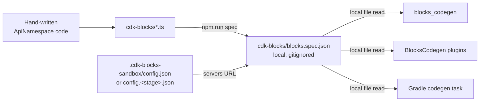

# Native Client Codegen — Design

This is the design rationale for how AWS CDK Blocks serves typed native clients (Swift, Kotlin, Dart) from a TypeScript API. It documents *why* the pipeline is shaped the way it is. For *how to write APIs that codegen well*, see [`schema-generation-guide-for-devs.md`](./schema-generation-guide-for-devs.md).

---

## Context

CDK Blocks' client-facing surface is `ApiNamespace` — a method-dispatch protocol over JSON-RPC 2.0. Every call goes to a single endpoint:

```
POST /api HTTP/1.1
Content-Type: application/json

{ "jsonrpc": "2.0", "method": "api.kvGet", "params": ["myKey"], "id": 1 }
```

The wire error contract follows CDK Blocks' core JSON-RPC implementation: reserved JSON-RPC errors use the standard negative codes (`-32700`, `-32600`, `-32601`, `-32602`, `-32603`), while application `ApiError`s use the positive HTTP status code as `error.code` and carry the structured name in `error.data.name` when available.

The TypeScript web client gets type safety for free — `client.js` is generated alongside the server. Native clients (Swift, Kotlin, Dart) need their own codegen pipeline.

### Reference architecture: MCP

The Model Context Protocol faces the same problem: a JSON-RPC based protocol with multiple interaction types and official typed SDKs in Swift, Kotlin, and TypeScript. MCP's approach:

1. **Canonical schema in TypeScript/Zod** — `schema.ts` is the source of truth
2. **JSON Schema export** — derived from Zod, used by all platform teams
3. **Platform SDKs** (`swift-sdk`, `kotlin-sdk`) — hand-written against the spec, handle transport and message framing
4. **App-specific usage** sits on top of the platform SDK

CDK Blocks differs from MCP in one place: MCP's protocol is fixed (tools, resources, prompts are standard interfaces), so the platform SDK alone is sufficient. CDK Blocks' `ApiNamespace` methods are **application-specific** — each app has different methods. This adds one layer:

```
MCP:             platform SDK  ←  app uses directly
CDK Blocks:  platform SDK  ←  generated typed facade  ←  app uses
```

The generated facade is thin: typed method wrappers that call into the platform SDK's transport primitive. The SDK owns the wire.

---

## The two-layer model

**Platform SDK** (`blocks-swift`, `blocks-kotlin`, `blocks-dart`) — built once, like MCP's SDKs:

- JSON-RPC transport (HTTP)
- Authentication (cookie management, token injection)
- Realtime hydration (WebSocket connections from `__blocks` descriptors)
- FileBucket hydration (presigned URL operations from `__blocks` descriptors)

**Codegen layer** — app-specific, generated from the spec:

- One typed method per `ApiNamespace` method
- Calls into the platform SDK's transport primitive
- No transport logic — the SDK owns that

```swift
// Platform SDK — hand-written (blocks-swift)
class BlocksClient {
	func call<P: Encodable, R: Decodable>(_ method: String, params: P) async throws -> R
}

// Generated facade — produced by codegen from the spec
class ApiClient {
	private let client: BlocksClient

	func kvGet(key: String) async throws -> String? {
		try await client.call("api.kvGet", params: KvGetParams(key: key))
	}

	func authSignIn(username: String, password: String) async throws -> AuthState {
		try await client.call("api.authSignIn", params: AuthSignInParams(username: username, password: password))
	}
}
```

The question this document answers: **what format does the codegen layer read?**

---

## Decision: OpenRPC over fabricated OpenAPI

The format is OpenRPC 1.3.2, emitted as `cdk-blocks/blocks.spec.json`. The alternative considered was OpenAPI 3.1 with fabricated paths.

### Why not OpenAPI

OpenAPI requires a `paths` section. CDK Blocks' API has one path (`POST /api`). To give a generator per-method operations, the build step would have to fabricate one fake path per method:

```yaml
# Fabricated — these paths do not exist on the server.
paths:
	/api/kvGet:
		post:
			operationId: kvGet
			requestBody:
				content:
					application/json:
						schema: { $ref: '#/components/schemas/KvGetParams' }
```

The generator reads `operationId` as the method name and the request/response schemas as types. The path string and HTTP verb carry no useful information.

**The fabricated spec can't be meaningfully exposed.** Swagger UI shows `POST /api/kvGet` — a path that 404s. An API gateway configured from this spec routes to endpoints that don't exist. Third-party consumers see a REST API they cannot call.

### Why OpenRPC

CDK Blocks' wire protocol already conforms to JSON-RPC 2.0 (`rpc.ts` handles encoding/decoding). OpenRPC is the natural description format for a JSON-RPC service:

- The generator reads `method.name`, `method.params[].schema`, and `method.result.schema` directly
- No REST structure to navigate, no fake paths to fabricate
- A real spec with a JSON Schema you can validate against
- Existing tooling for documentation rendering (OpenRPC playground/inspector)

OpenRPC's existing generators (`open-rpc/generator`) target TypeScript, Go, Python, and Rust — not Swift, Kotlin, or Dart. CDK Blocks still builds its own generator regardless. But the generator reads a standard format instead of a bespoke one.

### Single-file format

The OpenRPC document is emitted as a single self-contained file (`blocks.spec.json`) for the entire app, containing all `ApiNamespace` methods. Shared schemas use `components.schemas` with internal `$ref`s — no separate schema files. Example shape:

```json
{
	"openrpc": "1.3.2",
	"info": { "title": "api", "version": "1.0.0" },
	"components": {
		"schemas": {
			"AuthState": {
				"type": "object",
				"required": ["userId", "username", "createdAt"],
				"properties": {
					"userId":    { "type": "string" },
					"username":  { "type": "string" },
					"createdAt": { "type": "string" }
				}
			}
		}
	},
	"methods": [
		{
			"name": "api.authSignIn",
			"params": [
				{ "name": "username", "required": true, "schema": { "type": "string" } },
				{ "name": "password", "required": true, "schema": { "type": "string" } }
			],
			"result": {
				"name": "AuthSignInResult",
				"schema": { "$ref": "#/components/schemas/AuthState" }
			}
		}
	]
}
```

### CDK Blocks-specific extensions

Two `x-blocks-*` extension fields cover the gaps where standard OpenRPC doesn't capture CDK Blocks semantics: `x-blocks-transferable` and `x-blocks-type-args` (on result schemas for Realtime / FileBucket / OIDC handles).

The full reference, including the tag table for native codegen authors, lives in [`schema-generation-guide-for-devs.md` § Spec extensions reference](./schema-generation-guide-for-devs.md#spec-extensions-reference).

A tag maps to one runtime type, and the generated facade returns that type with the spec's type arguments applied (`RealtimeChannel<Cursor>`). One exception, on Dart only: an `oidc/client` whose spec names its providers returns `TypedOidcClient<P>`, an extension type over the runtime `OidcClient` that narrows `signInDirect`, `signIn` and `exchange` to the generated provider enum `P`. It adds no runtime type and no logic, only a compile-time view. Swift and Kotlin make `OidcClient` itself generic. Dart doesn't, for two reasons: a generic `OidcClient<P>` would break every caller that passes a provider's name, and, because Dart's generics are covariant and `P` only appears in parameters, an upcast client would fail on a wrong provider with a `TypeError` (and in a dart2js `-O4` build not at all). The view is covariant too (`TypedOidcClient<OidcProvider>` takes any provider), but it is erased, so a wrong provider always reaches `OidcClient`'s own check and fails on its name with `OidcUnknownProviderException`. See [`schema-generation-guide-for-devs.md`](./schema-generation-guide-for-devs.md#x-blocks-type-args-on-a-methods-resultschema).

#### Declared native packages and bindings

Two top-level extension objects let a block declare its own native package instead of relying on a generator's hard-coded tag switch.

`x-blocks-native-packages` is keyed by logical package identity. Each entry holds a `platforms` object whose `dart`, `swift`, and `android` fields are independently optional; a present field carries a `package` object naming the package-manager identity and the import or module name.

`x-blocks-native-bindings` holds an array of bindings. Each carries a stable `id`, a `kind` (only `transferable` in schema 1), and maps an exact `tag` to a package `export`, a factory `abi`, and a `genericArity` of 0 or 1.

A binding whose `kind` schema 1 does not define is skipped rather than rejected, and reported as `AWSBLOCKS-NATIVE-004`. The package-existence, tag-presence and tag-uniqueness checks run whatever the kind, so a binding naming an undeclared package, or re-binding a tag another binding already took, is a generation error regardless. A package a binding names is referenced whatever that binding's kind, so it alone does not raise `AWSBLOCKS-NATIVE-003`. `genericArity` is required, and a result whose `x-blocks-type-args` count disagrees with it is a generation error for the binding that emits. The remaining per-binding fields diverge on an undefined kind, because each generator validates only what its own emission reads (D-020) and a skipped binding emits nothing. Swift decodes the whole catalog before any kind gate and types `export` and `abi` as required strings with `genericArity` as an optional `Int`, and Dart's parser reads `abi` and `genericArity` before it reads `kind`, so a missing `abi` or `export` or a malformed `genericArity` is a generation error on both whatever the kind. An absent or out-of-range `genericArity` is an error on Dart alone, since Swift's presence and range guards sit behind its kind gate, and an `export` that fails the export grammar is caught on all three, each reaching that check only where a binding applies. Kotlin reaches none of the fields for a kind it does not emit, so the same binding generates with only `AWSBLOCKS-NATIVE-004`. The producer owns these fields for every kind: `validate-native-catalogs.ts` rejects such a catalog before `blocks.spec.json` is written. It also bounds `export` at 64 characters, which Kotlin's parser mirrors and Swift and Dart do not.

Both objects carry `schemaVersion: 1` and are emitted only when non-empty. An absent platform field means the package is not offered there, and that result degrades to `UnknownTransferable` on that platform alone.

A block authors both catalogs as static JSON under an `aws-blocks.native` key in its own `package.json`, rather than in a TypeScript registration call.

This supersedes the `Scope.registerNativePackage()` / `Scope.registerNativeBinding()` API specified in the native client codegen design. Declarations are carried in `package.json` because they are build-time dependencies; field names and nesting are unchanged, only the carrier moved.

See [D-019](../DECISIONS.md#d-019-native-declarations-are-read-from-every-resolvable-manifest-not-only-declared-dependencies) for the scan's trust boundary.

The `spec` task reads that key from every `node_modules` level from the spec project up to the filesystem root, resolving each import specifier to its nearest installed copy, and passes what it finds as `nativeDeclarations`.

#### Unbound transferables: the `UnknownTransferable` carrier

When a bare direct result's `x-blocks-transferable` tag has no known runtime binding, the native clients degrade it to a typed `UnknownTransferable` carrier, validated against the declared `__blocks` tag. A malformed descriptor raises the platform's standard decoding error: Dart `FormatException`, Swift `DecodingError`, Kotlin `TransferableException`.

The unbound fallback is direct-only; a transferable in any other position is unchanged from before the fallback, except that on Kotlin a nullable result still fails code generation.

A nullable result carrying a *built-in* transferable tag does hydrate to its optional concrete type. A declared binding reaches a nullable result on Swift and Kotlin, which unwrap the optional and emit the optional declared type, while Dart applies a declared binding to a bare direct result only, so on Dart alone a nullable result keeps the pre-fallback type. A nested or list-wrapped result keeps the pre-fallback type on all three, and does so silently — only a bare direct result reports `AWSBLOCKS-NATIVE-001`.

#### Native diagnostic codes

The `AWSBLOCKS-NATIVE-` numbers are one namespace shared by the Dart, Swift and Kotlin generators: a code means the same condition on every platform that emits it, and a retired code is never reused. Every code is a warning that still generates; what refuses a spec is a generation error and carries no code. An opt-out is build configuration that keeps a declared package unbound on that platform.

| Code | Reports | Dart | Swift | Kotlin | Status |
|---|---|---|---|---|---|
| `AWSBLOCKS-NATIVE-001` | A bare direct result whose `x-blocks-transferable` tag has no runtime or declared binding; the result is generated as `UnknownTransferable`. Swift appends the cause when a declared binding was dropped (the package is opted out, or declares no `swift` platform). | Yes | Yes | Yes | live |
| `AWSBLOCKS-NATIVE-002` | A direct or nullable `realtime/channel` result whose message type the Dart runtime's `Map`-only deserializer could not hydrate; the value was returned un-hydrated. Emitted on Dart only. The Dart generator now decodes a non-object message through `RealtimeChannel.fromJsonValue`, so the condition no longer exists. | — | — | — | retired |
| `AWSBLOCKS-NATIVE-003` | A declared native package that no binding references; nothing is imported for it. Kotlin omits a package that is also opted out; Dart and Swift report it regardless. | Yes | Yes | Yes | live |
| `AWSBLOCKS-NATIVE-004` | A binding whose `kind` schema 1 does not define; the binding is skipped. | Yes | Yes | Yes | live |
| `AWSBLOCKS-NATIVE-005` | A binding whose `tag` is a built-in transferable tag (`realtime/channel`, `file-bucket/download`, `file-bucket/upload`, `oidc/client`), which cannot be re-bound; the binding is skipped. | — | Yes | — | live |
| `AWSBLOCKS-NATIVE-006` | An opt-out that names a package the spec does not declare; nothing is opted out for it. | Yes | Yes | Yes | live |

#### Open enums: values a client doesn't know

A string enum that a response can carry is generated *open*: a value the client was generated without decodes instead of failing, keeps the string as the server sent it, and encodes back as that string. A server can add a value (a new auth state, field type or action capability) without breaking clients already shipped. "Response" is decided per generator from the spec: an enum is open when a method's result reaches it at any depth, through models, union arms, lists, maps, optionals, tuples and a transferable's type arguments. An `oidc/client`'s type argument is the set of providers a caller may pass, so it is not a response position. A component enum is open when a result reaches that component, even if parameters use it too; an inline type that only shares its name doesn't count. An enum used in both positions is open in both, so a client can send back a value it received and didn't know: it re-encodes as the server sent it, and the server still validates it. Only an enum that parameters alone use stays closed. There is no spec marker for this; position is enough.

| SDK | Open enum `X` | Unknown value | Exhaustive match |
|---|---|---|---|
| Dart | `sealed class X`; known values are the constants of `enum XKnown implements X`, which `X.a` and `X.values` alias | `XUnknown(value)` | `switch` needs an `XUnknown()` case |
| Swift | `enum X: RawRepresentable, Codable, Hashable` with a non-failable `init(rawValue:)` | `case unknown(String)` | `switch` needs `.unknown` |
| Kotlin | `sealed class X` with a string serializer; known values are `data object`s named as enum constants, listed in `X.entries` | `X.Unknown(value)` | `when` needs `is X.Unknown` |

When a spec value already takes the fallback's name, the spec value keeps it and the fallback steps aside: Swift `unknownValue`, Kotlin `UnknownValue` (and a value named `companion` makes Kotlin name the companion object `Known`). In Dart a spec value can't take the fallback's name; when another type of the library already has the name `XKnown` or `XUnknown`, the generated class takes a trailing `$` (`XUnknown$`). Decoding maps a known string to its known case, so a hand-built unknown case holding a known string (`X.Unknown("a")`) is not equal to that case. A union without a discriminator decodes by trying each arm in turn, and an open enum would accept every string, so an enum arm accepts only the values it declares: Swift checks the decoded value against them, Kotlin matches the arm by its literal values, and Dart types such a union `dynamic`. An inline enum arm stays closed in Swift. Every type an object arm of such a union reaches, at any depth, is closed in Swift and Kotlin, even where it also appears elsewhere in a result: open, an enum inside the first arm with matching keys would take an object meant for a later arm and drop that arm's fields. Dart keeps such a type open where another result reaches it, since its union is `dynamic` and never decodes the arms.

Unions follow the same rule. A union with a JSON string discriminator whose arms are all objects, when a method's result reaches it, gets one extra arm for an object whose discriminator names no arm. That arm holds the object as the server sent it and encodes it back as equal JSON: Dart `XUnknown` (with `json`, a copy from `toJson()`, and `discriminator`), Swift `case unknown(JSONValue)` (with the union's `unknownDiscriminator`), Kotlin `X.Unknown(json: JsonObject)` (with `discriminator`; Kotlin generates the union's serializer for this, since kotlinx's sealed-class serializer can't fall back). An arm tagged `unknown` keeps its own name, so the fallback steps aside: Swift `unknownValue`, Kotlin `UnknownValue`. An exhaustive match over such a union needs the fallback case. An unknown arm's JSON can carry fields that a generated type would never expose, so don't log or display it whole; read the fields you need. These stay closed: a union only parameters use, one with a boolean discriminator (`true`/`false` is already exhaustive), one with a bare value arm or no discriminator (there is no tag to call unknown), and a union embedded in another arm's object, which shares that object.

| SDK | Unknown arm of `X` | Its tag | Hand-built without a tag |
|---|---|---|---|
| Dart | `XUnknown(json)` | `discriminator` (`String`) | `discriminator` throws |
| Swift | `case unknown(JSONValue)` | `unknownDiscriminator` on `X` (`String?`) | `unknownDiscriminator` is `nil` |
| Kotlin | `X.Unknown(json: JsonObject)` | `discriminator` (`String`) | `discriminator` throws |

Decoding only builds the unknown arm for an object whose tag is a string, so the last column applies to an arm an app builds itself.

---

## Authoring progression: plain TypeScript → Zod

The spec emitter resolves types in three tiers, in order of precision:

1. **Zod schemas** — if a method calls `.parse()` on an exported Zod schema, the emitter extracts full JSON Schema with constraints (`format: uuid`, `maxLength`, etc.)
2. **TypeScript types** — the emitter uses `ts.createProgram` with a full type checker to resolve method signatures and inferred return values
3. **`unknown`** — fallback when both tiers fail

This is what app developers actually choose between when writing their `ApiNamespace`. Both tiers ship today; both are documented in `schema-generation-guide-for-devs.md`.

### Tier 2: plain TypeScript

```ts
type Post = {
	id: string;
	title: string;
	body: string;
	createdAt: string;
};

export const api = new ApiNamespace(scope, 'api', (context) => ({
	async getPost(id: string): Promise<Post> {
		return db.posts.findOrThrow(id);
	},
}));
```

Produces an OpenRPC document with base types only — `id` is `{ "type": "string" }`, no `format: uuid`. Native codegen produces `String`, not `UUID`.

There is no runtime validation. TypeScript types are erased; the server has no mechanism to reject malformed input unless the developer writes a check by hand. Renaming a field changes the wire contract silently.

This tier is fine for prototypes and internal APIs where the TS frontend and server deploy together. It's not enough when native clients ship independently.

### Tier 1: Zod schemas

```ts
const PostSchema = z.object({
	id: z.uuid(),
	title: z.string().max(120),
	body: z.string(),
	createdAt: z.iso.datetime(),
}).meta({ id: 'Post' });

const GetPostInput = z.object({ id: z.uuid() });

export const api = new ApiNamespace(scope, 'api', (context) => ({
	async getPost(rawInput: unknown): Promise<z.infer<typeof PostSchema>> {
		const { id } = GetPostInput.parse(rawInput);
		return db.posts.findOrThrow(id);
	},
}));
```

What changes from tier 2:

- `z.uuid()` validates at runtime *and* emits `format: uuid` in the spec
- `z.string().max(120)` rejects oversize strings *and* emits `maxLength: 120`
- `z.infer<typeof PostSchema>` produces the TypeScript type — one source of truth

Native codegen now produces `UUID` for `id` and `Date` for `createdAt`. The wire contract is explicit; CI can diff the spec to detect breaking changes.

The trade-off is one parallel definition layer per method (the schema). Schemas do two jobs (validation + spec emission) that plain TS can't do at all, so the verbosity earns its keep when native clients are in the mix.

---

## Build pipeline

The OpenRPC document is emitted at build time, alongside the existing `client.js` codegen. The mechanism is shared: dynamically import the backend, discover `ApiNamespace` exports via `API_NAMESPACE_MARKER`, introspect methods, and emit the document. See `packages/core/src/scripts/generate-spec.ts` for the implementation.

```
cdk-blocks/
	blocks.spec.json        # all namespaces, all methods
```

**Environment config** — the CLI populates the OpenRPC `servers` array with the API URL of the running dev server (`.cdk-blocks-sandbox/config.json`) or, with `BLOCKS_SPEC_STAGE=sandbox` or `production`, of that stage's last deploy (`.cdk-blocks-sandbox/config.<stage>.json`). A deploy never writes `config.json`, so a spec targets AWS only when you ask:

```json
{
	"openrpc": "1.3.2",
	"servers": [{ "name": "default", "url": "https://abc123.execute-api.us-east-1.amazonaws.com/api" }],
	"methods": [ ... ]
}
```

If that file does not exist (no dev server has run, or the stage was never deployed from this machine), the `servers` array is omitted and native SDKs must get the endpoint URL from their own environment config at runtime.

The spec describes the API shape. The `servers` entry is a convenience for codegen tools that want a default URL, but the platform SDK should still support runtime URL override for multi-environment deployments.

---

## What's not in the spec

Two pieces native SDK authors need that the spec deliberately does not carry:

1. **Wire-level protocol details** for non-RPC transports — WebSocket subprotocol names, message frames, auth flow for Realtime. These live in per-BB protocol docs (`packages/bb-realtime/PROTOCOL.md` and similar). Embedding them in the spec as static JSON would be docs-with-extra-steps: same content, harder to read, no machine consumer to justify the format.

2. **Per-environment endpoint URLs.** The `servers` array is populated from the local sandbox config when available, but it's a single snapshot — not a multi-environment registry. Production, staging, and local URLs are managed by the platform SDK's runtime config, not baked into the spec.

---

## Spec trust model

The native generators (Dart, Swift, Kotlin) treat `blocks.spec.json` as the source of truth and copy schema-controlled strings from it into generated source: field and parameter names used as JSON keys, descriptions (where a generator emits them), patterns, enum values, discriminator properties and tags, RPC method names, server URLs, and defaults. Each generator routes every such value through its own string-literal escaper, so any character in a spec value produces well-formed generated code that carries the value verbatim at runtime and does not change the structure of the generated program.

The spec is a build input with the same trust as the backend source it is generated from: a developer generates it locally from their own backend, and the generated client compiles into their own app. The generators do not rely on that, though. Names the spec supplies that become identifiers (type and schema names, field and property names, enum cases, operation, parameter, namespace and server names) are turned into identifiers by each generator: Kotlin keeps a name it can declare in backticks and otherwise builds one from the name's letters and digits; Dart builds one from the name's letters and digits and escapes the rest with `$`; Swift replaces every character that isn't a letter, digit or `_` with `_`, prefixes `_` to a leading digit, and gives a name left empty or holding only underscores an `unnamed` suffix. Where two names in one scope end up the same, the later one steps aside (`_2`, `_3`, … on Kotlin and Swift, a trailing `$` on Dart). The original name still reaches the wire, emitted only as an escaped string literal (`@SerialName` on Kotlin, a `CodingKeys` raw value on Swift, the JSON map key on Dart). The `43-non-identifier-names` fixture compiles each generator's output for a spec whose names are not identifiers.

### Where the spec comes from today



- **Generated locally.** `generate-spec-cli.ts` (via `npm run spec` in scaffolded apps) imports the backend entry and writes `cdk-blocks/blocks.spec.json`. It is run explicitly, not as part of `npm run dev` or deploy.
- **Gitignored in apps.** Every `create-blocks-app` template, and the entries `create-blocks-app` adds when initializing an existing directory, ignore `cdk-blocks/blocks.spec.json`. (This repo commits a few specs as Swift test fixtures under `native/swift/Tests/`.)
- **Not served by the deployed API.** No runtime or CDK code reads or bundles the spec, and the JSON-RPC handler has no discovery method that returns it.
- **Read from a local path, no network fetch.** Dart reads `*.spec.json` build assets (`builder.dart`) or `--spec <path>` (CLI); the Swift plugins pass the target's `blocks.spec.json` file to the generator, which reads it with `FileManager`; the Kotlin task reads `cdkBlocks.apiSpec` (default `rootProject/blocks.spec.json`) with `readText()`.

### Sharing a spec

The escaping and identifier sanitizing above apply to any spec the native generators accept. A spec that does not come from your own backend source is a different input, though: when one team generates the spec and another generates clients from it (a backend team handing a spec to a mobile team, for example), treat the spec as untrusted input. Review changes to it as you would review code, and version the generated client code as you would any other generated artifact.

---

## Cross-cutting practices

These apply once native clients are in production. They are deliberately out of scope for the initial spec emitter.

### Typed error responses

OpenRPC's `errors` field on each method, populated from Zod error schemas, lets native codegen produce exhaustive `switch` over typed error variants instead of opaque error strings. Currently the emitter does not extract these; adding it is mechanical when there's a customer for it.

### Breaking change detection in CI

Commit `blocks.spec.json.lock` alongside source. CI diffs the lockfile against the freshly generated spec on every PR:

- Method-level changes (added, removed, renamed) — trivial `jq` diff
- Schema-level changes (property renames, type narrowing) — JSON Schema diffing

Block merges that introduce breaking changes unless tagged `breaking-change`.

### Publish generated clients as versioned packages

Rather than having native engineers run codegen locally against the server repo, publish:

```
@yourco/api-client-swift    → Swift Package Manager
@yourco/api-client-kotlin   → Maven Central
@yourco/api-client-dart     → pub.dev
```

Native engineers pin a version and upgrade deliberately. Server breaking changes become version bumps, not silent runtime failures.
