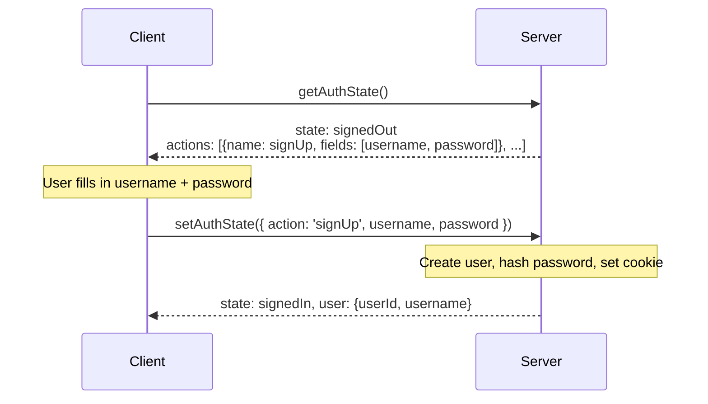
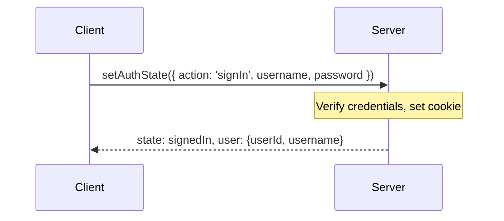
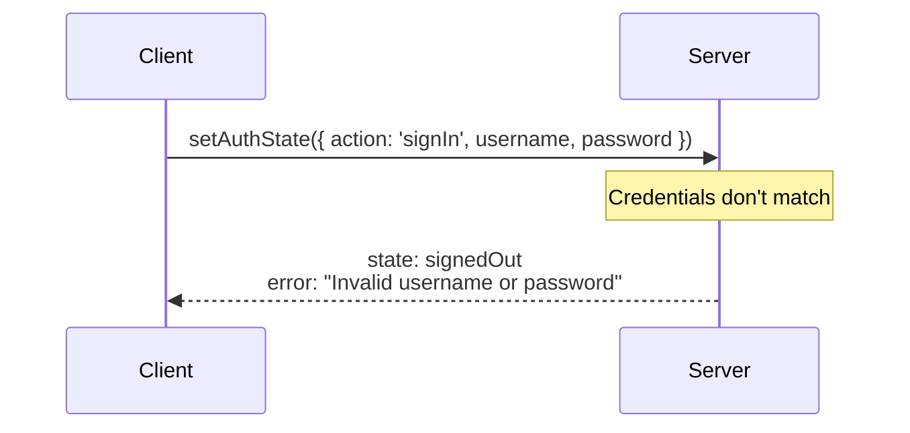
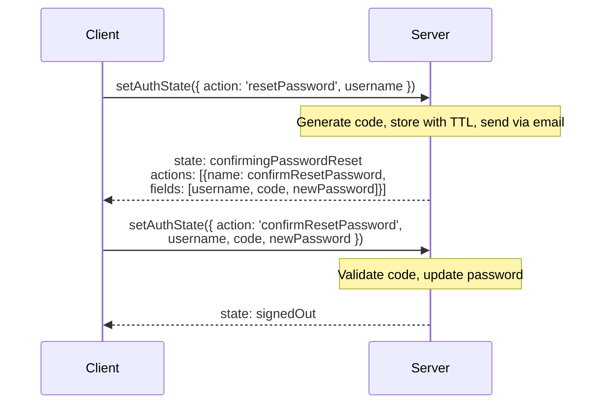
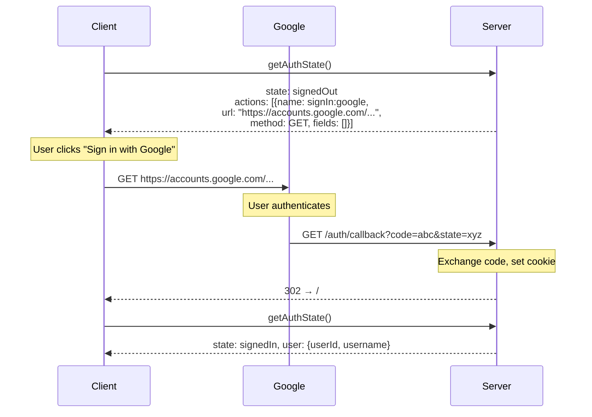
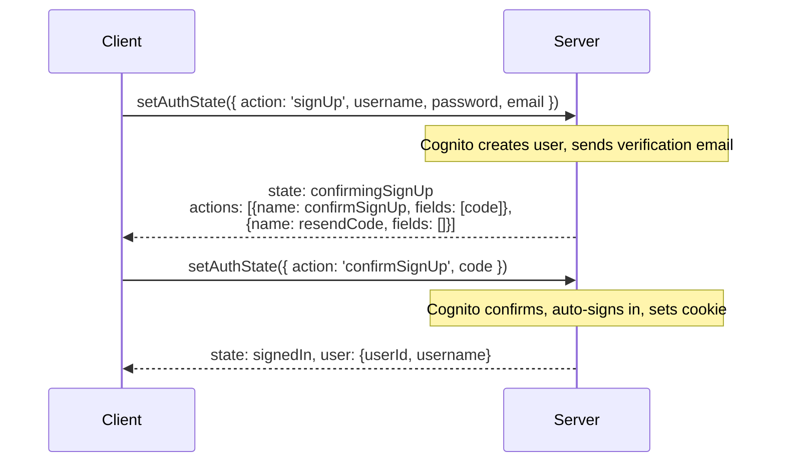
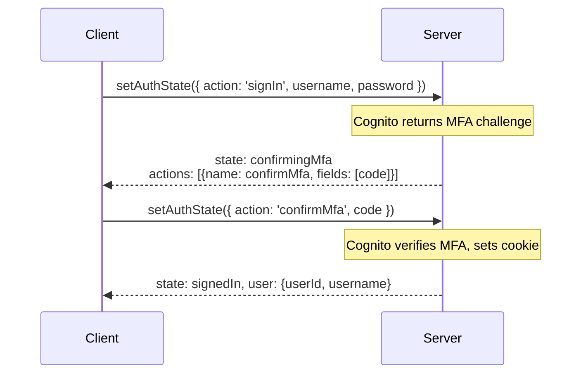
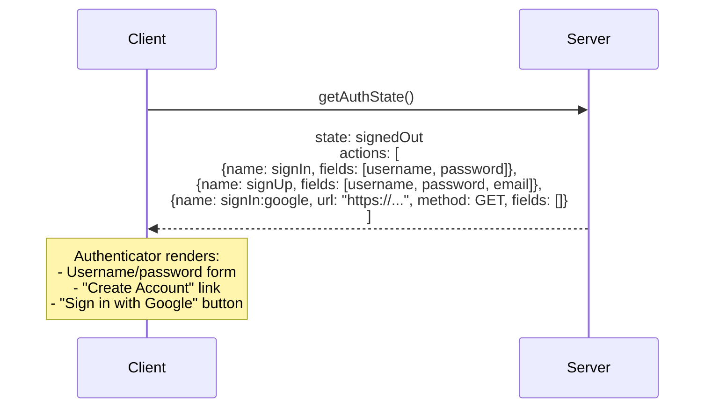

# Auth Common — Design

Design document for the auth common package. For usage, see [README.md](./README.md).

**Package:** `@aws-blocks/auth-common`
**Type:** Shared interface (not a standalone Building Block)
**AWS Service:** None — defines the contract that `Auth` (`@aws-blocks/bb-auth`) implements. It was written for, and implemented by, the three blocks `Auth` replaced: `AuthBasic`, `AuthOIDC` and `AuthCognito`.

## Purpose

All auth Building Blocks should look and work the same from the customer's perspective. This package defines:

1. `BlocksAuth` — server-side interface all auth BBs implement
2. Auth state machine types — drive a provider-agnostic Authenticator component
3. UI components — `Authenticator`, `AuthenticatedContent`, `AccountMenuBar`, `StatusMessage` (a presentational status-line primitive; see the README), `onAuthChange`, `broadcastAuthChange`, plus the client-side notifier `submitAuthAction` and the auth-state store (`subscribeAuthState` / `getAuthStateSnapshot`)
4. `AuthErrors` — the canonical auth error-name vocabulary, plus the `isAuthError` / `isAuthErrorName` guards

## State Machine Design

Auth is driven by a state machine. The server returns an `AuthState` describing what the client should render and which actions are available. The client renders UI for those actions and submits results back.

Two API methods drive the loop:

- `getAuthState()` — returns the current `AuthState`
- `setAuthState({ action, ...fields })` — submits an action, returns the new `AuthState`

### Unified Form Model

All actions are forms. There is no separate "redirect" action type. Forms differ only in where they submit:

- **Internal forms** (no `url`): client collects field values and calls `setAuthState({ action, ...fields })`
- **External forms** (with `url`): client submits a regular HTML form to that URL via GET or POST

This is a deliberate design choice. OAuth/OIDC sign-in is just a form that submits to an external URL, the same mental model as any other form. The server bakes all OAuth parameters (client_id, scope, state nonce, etc.) into the `url` when constructing the `AuthState`.

### States

States are intentionally minimal — only states where the client must act are represented. Transient server-side states (validating credentials, exchanging tokens) resolve before the response is returned.

| State | Meaning |
|---|---|
| `signedOut` | No session |
| `signedIn` | Authenticated, `user` is present |
| `confirmingSignUp` | Account created, awaiting verification code |
| `confirmingMfa` | Credentials valid, awaiting MFA code |
| `confirmingPasswordReset` | Reset requested, awaiting code + new password |

### Auth Flows

These flows were drawn against the three predecessor blocks and still illustrate the state machine. With `Auth`, sign-up always goes through `confirmingSignUp` (the *AuthCognito* flow — *AuthBasic*'s instant sign-up no longer exists), the email + password flows are the *AuthCognito* ones, and a directly federated OIDC provider follows the *AuthOIDC* flow, with its callback at `/aws-blocks/auth/callback`.

#### AuthBasic: Sign Up

#### AuthBasic: Sign In

#### AuthBasic: Sign In (wrong password)

#### AuthBasic: Password Reset

#### AuthOIDC: Sign In with Google

#### AuthCognito: Sign Up with Email Confirmation

#### AuthCognito: Sign In with MFA

#### AuthCognito: Mixed Form + Federated

## `BlocksAuth` contract notes

- **Method shorthand, on purpose.** Every member is declared as a method (`requireAuth(context): …`), never as a property holding a function type. Under `strictFunctionTypes`, property-style function types check parameters contravariantly, while methods are checked bivariantly. Implementations narrow parameters (e.g. `Auth.requireRole` accepts only its declared group names, as `AuthCognito.requireRole` did), and only method shorthand lets those implementations satisfy the interface. `src/blocks-auth.types-test.ts` pins both the passing case and the property-syntax counterexample.
- **`requireRole` is required.** `Auth` implements it. It was optional while two of the blocks `Auth` replaced (`AuthBasic`, `AuthOIDC`) existed, because they had no roles; it became a required member when they were removed.
- **The 401 name is `NotAuthenticatedException`.** `Auth` throws it from `requireAuth`, as `AuthCognito` and `AuthOIDC` did (the removed `AuthBasic` threw `SessionExpiredException`).

## Auth error vocabulary

`AuthErrors` (`src/errors.ts`) is the one set of error names the `Auth` block throws. Names follow Amazon Cognito's exception names wherever Cognito has one; the federation-flow names keep the same `*Exception` suffix. Matching is by `name` (`isAuthError` / `isBlocksError` on a thrown error, `hasAuthError` on a returned `AuthState`), which works the same on server and client.

Adding `AuthErrors` changed nothing about what the predecessor blocks threw. There are **no runtime aliases**: a caller matching an old `AuthBasic` name will not match the new one, so each rename below is a breaking change when `AuthBasic` callers move to `Auth` (see [`MIGRATION.md`](../bb-auth/MIGRATION.md#error-names)).

### Mapping from today's names

`src/errors.test.ts` holds this table as data and fails when any of the three auth BBs' sources contain an error name with no row, so the table cannot fall behind.

| Source | Today's name | `AuthErrors` | Change |
|---|---|---|---|
| `AuthCognito` | all 29 `AuthCognitoErrors` | same keys, same values | unchanged |
| `AuthOIDC` | all 8 `AuthOIDCErrors` | same keys, same values | unchanged |
| `AuthBasic` | `InvalidPassword` → `InvalidPasswordException` | `InvalidPassword` | unchanged |
| `AuthBasic` | `InvalidCredentials` → `InvalidCredentialsException` | `NotAuthorized` → `NotAuthorizedException` | renamed |
| `AuthBasic` | `UserAlreadyExists` → `UserAlreadyExistsException` | `UserAlreadyExists` → `UsernameExistsException` | renamed (key kept, value changes) |
| `AuthBasic` | `SessionExpired` → `SessionExpiredException` | `NotAuthenticated` → `NotAuthenticatedException` | renamed |
| `AuthBasic` | `InvalidCode` → `InvalidCodeException` | `CodeMismatch` **and** `ExpiredCode` | **split** — wrong code vs. expired / no outstanding code. Every `isBlocksError` / `hasAuthError` call site matching `InvalidCode` needs a manual decision; there is no mechanical rename. |
| `AuthOIDC` | `AuthOIDCEngineError` (plain `Error`, Cognito-federation engine) | `ProviderNotConfigured`, `InvalidState`, `InvalidCallback`, `IdpError`, `TokenExpired` | **split** — by failure: provider not configured; pending cookie / state mismatch; missing code; token exchange failed; refresh failed |
| `AuthOIDC` | `AuthOIDCConfigError`, `RelayConfigError` (plain `Error`) | — | excluded: constructor-time configuration mistakes stay plain `Error`s with no constant ([D-AB-10](https://github.com/aws-devtools-labs/aws-blocks/blob/b58f248706bba1cfd3a73308dddb92a5733f6da8/packages/bb-auth-basic/DESIGN.md#d-ab-10-named-error-constants-only-for-user-facing-input-errors), in the removed `bb-auth-basic`) |
| `AuthOIDC` | `ResourceNotFoundException`, `DuplicateProviderException` | — | excluded: Cognito SDK errors caught inside the IdP-registration custom-resource Lambda, never surfaced |
| `AuthCognito` | `AccessDeniedException`, `UnrecognizedClientException`, `InvalidSignatureException`, `ExpiredTokenException`, `CredentialsProviderError` | — | excluded: AWS rejected the function role's own credentials or IAM policy, which is a deployment problem and not an auth outcome. Reported by name as a 500 with a generic message; the detail (role ARN, account id) is logged, never sent to the client |

New names with no predecessor: `ReauthenticationRequired`, `ProviderMisconfigured`, `EmailPasswordNotEnabled`, `NoFederatedProvider`, `PasskeysNotEnabled`, `MfaNotEnabled`.

`AuthCognito` also passed any other Cognito exception through by its service name (e.g. `CodeDeliveryFailureException`); those are not part of the vocabulary, and `Auth` reports them as `InternalErrorException`.

## Cross-Tab Auth State Broadcasting

Auth state changes are broadcast via two mechanisms:

1. `BroadcastChannel('blocks-auth')` — delivers to other tabs/windows with the same origin
2. `window.dispatchEvent(new CustomEvent('blocks-auth-change'))` — delivers to the same window (BroadcastChannel only fires on *other* contexts)

The `broadcastAuthChange()` function fires both. `onAuthChange()` listens to both, and `AuthenticatedContent` and `AccountMenuBar` render through it. The channel name, the event name and the `{ type: 'auth-change', user }` payload are a wire format: tabs running an older and a newer bundle coexist during a deploy, so none of them may be renamed.

### One notifier, two views

`setAuthState()` is a plain RPC. It runs in Node too (SSR, cookie-jar scripts, e2e clients), so it never touches the client state. `submitAuthAction(api, input)` is the single client-side notifier, and every built-in submit path goes through it (the `Authenticator` form and Enter key, the slot `submit` helper, the auto sign-in chain, `AccountMenuBar`'s Sign Out). It:

1. calls `setAuthState(input)` once and returns its result unchanged;
2. on `retriable: true`, stops there — the caller keeps the current form and its hidden fields;
3. otherwise writes the per-`api` store (a `WeakMap` keyed by the `api` object's identity);
4. and broadcasts `user ?? null` when the resulting state is `signedIn` or `signedOut`. The trigger is the resulting state, not a diff, so a tab that missed a broadcast still converges. Mid-flow challenge states are not broadcast.

Outside a browser it is just the RPC: a module-level store keyed by a shared server-side `authApi` would leak one request's state into another.

That gives two views of one source:

| View | API | Fires on |
|---|---|---|
| User-level | `onAuthChange` | sign-in / sign-out broadcasts (this window and other tabs), plus its synchronous first frame and hydration, and any other change of the store's user (it follows the store) |
| State-level | `subscribeAuthState` / `getAuthStateSnapshot` | every store write: hydration, every non-retriable `submitAuthAction` result the store takes (including mid-flow states; see "Ordering answers" for the ones it drops), and a cross-tab refetch |

The store's only inputs are hydration (one shared in-flight `getAuthState()` per `api`), `submitAuthAction`, and a cross-tab refetch: a broadcast from another tab triggers one `getAuthState()` per `api` that has store subscribers (the `Authenticator` is one), installed with the first subscriber and removed with the last. A same-window broadcast is not refetched, because `submitAuthAction` already wrote the store. The snapshot keeps its identity between writes, as `useSyncExternalStore` requires.

`submitAuthAction` tags its broadcast, in this window and to other tabs, with the RPC namespace of the API it ran on (the generated client answers `Symbol.for('aws-blocks.apiNamespace')` with it, the same in every tab): another API's `onAuthChange` skips the message and its store does not refetch, so signing in to one auth block never hands its user to another's listener. An untagged message (`broadcastAuthChange(user)` without an `api`, or a tab running an older `@aws-blocks/auth-common`) reaches every API, as before; so does any message for an API that is not a generated client. The id includes an overridden URL: on one backend, `generateClient({ url: X }).authApi` is `X#authApi` and the default client's `authApi` is `authApi`, so neither gets the other's tagged messages.

### Ordering answers

Requests overlap: a hydration is in flight when the user signs in, another tab's broadcast starts a refetch while this tab signs out, answers arrive in any order, and some fail. The store's rule decides which answer it shows. It is written from how the session cookie behaves, which the race tests model (`src/test-support/auth-store-races.ts`, run by `ui.races.*.test.ts`):

- A read (`getAuthState()`) carries the cookie the browser holds when it is **sent**, so it tells the session as of then.
- An action that sets or clears the session (a `signedIn` answer, or the answer to `signOut`) changes the cookie when its answer **arrives** (`Set-Cookie`), so it tells the session as of then.
- Any other answer — a challenge step, a failed sign-in, a resend, a confirmed sign-up — leaves the session as it was. It is this tab's place in a flow, not news about the session.

The rule:

1. **Reads are ordered by when they were sent, session actions by when they were answered**, on one clock per `api`. The newest of them is the session answer. An answer older than the current one is dropped, so a stale refetch or hydration never overwrites a newer sign-in or sign-out, and a session action's answer is never masked by an older read.
2. **A flow answer is shown over a signed-out session.** This tab's place in the flow is its latest-arriving flow answer that is not moot. A flow answer is moot once the session is seen signed in after it was sent (a signed-in read sent later) or changed here after it was sent (a session action answered later): another tab finished signing in, or this tab did. A signed-out read does not end it — another tab's sign-out does not cancel this tab's MFA step.
3. **When the answers cannot settle it, the store re-reads** (one `getAuthState()`), and keeps showing what it showed until the answer lands (the flow if it was showing it, else the session answer):
   - a flow answer under a signed-in session answer sent before it — the session may have timed out (the user is signing in again), or may still be live (a resend raced another tab's sign-in);
   - a session action that another request was sent during — the server may have handled that request before the action took effect or after.
4. **A failed request changes nothing.** It never empties the store and never blocks an older answer still in flight (a hydration still lands when a refetch fails). The store does not retry it.

Known limitations, all on failure paths and all settled by the next broadcast, submit or reload:

- **A failed re-read keeps what was shown.** The store does not retry the re-read of rule 3, and it does not fall back from what it showed when that read fails. If a session timed out and the user signed in again and got an MFA step, the store keeps showing the signed-in state. If this tab is showing an MFA step, another tab signs in (a read already says so, but was sent before the step) and the re-read fails, the MFA step stays shown although the session is signed in.
- **Keeping a broadcast when its refetch fails has a cost.** If another tab signs out, this tab then signs in, and the other tab's broadcast arrives late and its refetch fails, `onAuthChange` keeps that broadcast's `null` although this tab is signed in (the store shows the sign-in).

Display: the session answer if it is signed in, else the flow answer if there is one, else the session answer. `submitAuthAction` broadcasts a `signedIn` / `signedOut` result when the store shows it, which a session action's result always is. A result the store does not show is not this tab's state and is not broadcast: a failed sign-in sent before the session was seen signed in, or one under a signed-in state the store is re-reading.

`onAuthChange` follows the store: it takes broadcasts at their word as before, and then emits the store's user whenever that differs from what it emitted — after the refetch a cross-tab broadcast triggers (so a stale broadcast is corrected) and when the store re-reads. An answer the store learned before the last broadcast arrived is older than that broadcast and is emitted only if it agrees with it, so when the refetch fails the broadcast stands: a sign-out another tab made stays a sign-out on a network blip, even though the store still shows the user it knew. Otherwise it ends where `subscribeAuthState` does. A user equal to the last one it emitted is not emitted again (a broadcast still is, as before). Since it follows the store, an `api` with only `onAuthChange` subscribers (`AuthenticatedContent`, `AccountMenuBar`) also sends one `getAuthState()` per broadcast from another tab.

The race tests check this exhaustively: every interleaving of up to three concurrent operations (hydration, another tab's sign-in or sign-out and the refetch it triggers, a submit with a terminal result, a submit with a mid-flow result, a session timeout followed by a new sign-in, and failures of each), for one and two APIs, both with this cookie timing and with the old naive timing in which a request's effect lands when it is sent. After every event the snapshot must be the one the rule names; once everything settles it must equal the session's truth (a fresh read, or the step the tab is still in) when no request failed, `onAuthChange` must agree with it (or hold the last broadcast, when a refetch failed), and nothing may cross APIs. With cookie timing, `onAuthChange`'s emissions are also checked against the server's session: once it reported a sign-out the server had made, it reports a user again only after a sign-in since (another tab's late broadcast excepted: it names a sign-in that happened, and the refetch corrects it). Reads are bounded by their causes (one per API, broadcast, action and failure), and a run that does not settle, or an enumeration that overruns its time budget, fails.

`npm test` runs the one-API sets and the two-API sets of up to two operations (about 1.2 million interleavings). The two-API, three-operation sets (about 8.6 million more) run with `AUTH_STORE_RACES_FULL=1`; the `Auth Store Races` workflow does that on every PR that changes `src/ui.ts` or the race model. Run it locally the same way after changing the store: `AUTH_STORE_RACES_FULL=1 node --test dist/ui.races.*.test.js` in this package.

Follow-ups:

- **A bounded fallback for a failed re-read.** Falling back from a held step to the signed-in answer whenever the re-read fails loses live steps (an older read still in flight may yet say `signedOut`) and can re-emit a stale user. A fallback is safe only when the signed-in session answer is newer than the last broadcast heard and than every read still in flight; the race suite (with the oracle checking the end state against the server's session on failure paths too) is the check for it.
- The ordering itself (`sendRead`, `takeAction` and the display choice in `updateState`) could move into a pure reducer module so `ui.ts` keeps only the DOM and broadcast wiring; the race suite in full mode is the check that such a move changes nothing.

The model takes a failed request to have never reached the server; a request the server handled whose answer was then lost is outside it (the store keeps what it showed, and the next broadcast or reload corrects it).

## Cookie Management

All auth BBs manage session cookies via `BlocksContext`:

- **Setting cookies:** By default the BB sets an `HttpOnly`, `SameSite=Lax` cookie (`Secure` in production) on `context.response.headers` after successful authentication. When `crossDomain: true`, it switches to `SameSite=None; Secure; Partitioned`. See [D-007](../../docs/DECISIONS.md#d-007-auth-cookies-default-to-samesitelax-cross-domain-is-opt-in).
- **Reading cookies:** `requireAuth`/`checkAuth`/`getCurrentUser` read the session cookie from `context.request.headers`
- **Clearing cookies:** `signOut` clears the cookie via `Max-Age=0`

The cookie contains a signed JWT. The BB handles token validation internally — customers never touch tokens directly.

## Design-Token Layer (self-injecting theme)

The UI components are vanilla-DOM factories by design, so they drop into
lit-html, vanilla, React, and Next.js alike. Styling them had to preserve
that neutrality: a React-only component library (Cloudscape, MUI) cannot
restyle a vanilla-DOM component, and a separate stylesheet every host must
import renders unstyled the moment a host forgets the import.

The chosen design is a **framework-neutral token layer that travels with
the component**. `theme.ts` exports the stylesheet as a string
(`THEME_CSS`) — CSS custom properties on `:root` plus base `.bb-*`
classes — and an idempotent `injectTheme()` that appends it to
`document.head` once (keyed on `THEME_STYLE_ID`). Every UI factory calls
`injectTheme()` before building its DOM and renders against the classes
instead of inline styles, so the themed look is present wherever the
component is mounted, with zero host wiring.

Rationale, versus the alternatives:

- **No new runtime framework dependency.** CSS variables are the most
  portable, longest-lived styling primitive, and they outlive any
  component-library major version — the right choice for code shipped for
  customers to copy and learn from.
- **Single source of truth.** One token layer backs both the Auth
  components and the starter templates (which reference the same `--bb-*`
  variables for their own markup), so a palette or spacing change is one
  edit.
- **Mock/host neutral.** `injectTheme()` is SSR-safe (returns silently
  with no `document`), so server-rendering a host page never throws; the
  tokens apply once the component paints in the browser.

Light and dark palettes are driven by `prefers-color-scheme`, with a
`data-bb-theme="light" | "dark"` ancestor attribute as an explicit
override that wins over the media query.
